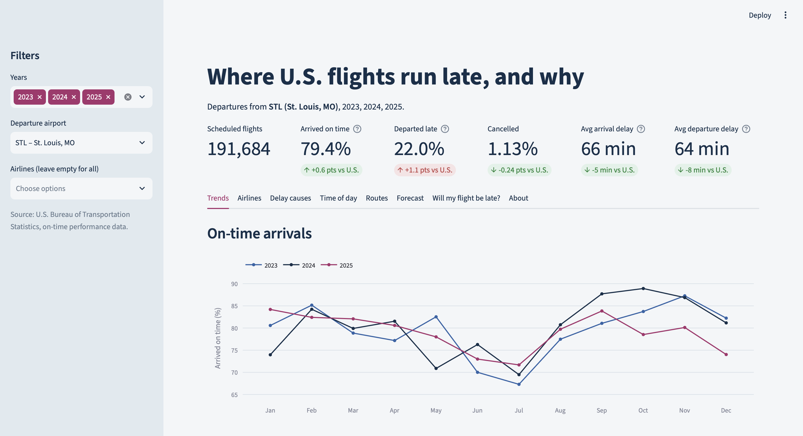

# ✈️ U.S. Flight Delay Intelligence

**Live dashboard:** [us-domestic-flight-delays.streamlit.app](https://us-domestic-flight-delays.streamlit.app)

Where U.S. flights run late, and why. An end-to-end analysis of **20.9 million domestic flights
(2023–2025)** from the U.S. Bureau of Transportation Statistics, with an interactive dashboard,
a delay forecast, and a model that estimates any flight's chance of arriving late.



## Key findings

**1. When you fly matters more than who you fly.**
Flights leaving around 5 AM were delayed only **8.9%** of the time, versus **30.7%** around 8 PM,
more than 3× worse. Delays snowball through the day: late-arriving aircraft cause **39.9%** of all
delay minutes, the single biggest cause, as one late plane pushes delays onto the flights it
operates afterward.

**2. July is the worst month to fly; fall is the best.**
**29.0%** of July flights arrived late, versus **16.2%** in November. Summer combines the busiest
schedules of the year with frequent afternoon thunderstorms.

**3. The regional airlines beat the brands they fly for.**
Endeavor Air (Delta Connection) was the most punctual airline at **85.1%** on time, followed by
Republic Airways at **83.5%**. Among the major brands, Delta led at **82.2%**, while Frontier
(**70.7%**) and JetBlue (**72.2%**) ranked last. *(Airlines with 100,000+ flights.)*

**4. The Northeast has the roughest disruptions; the West is the most reliable.**
Northeast airports have more than double the West's cancellation rate (**2.09% vs 0.94%**) and the
longest delays (**77 vs 64 minutes** on average when late). The single worst route group is the
Northeast to the U.S. territories, mainly San Juan, where **31.6%** of flights ran late.

**5. Single events show up clearly in the data.**
On **July 19, 2024**, the CrowdStrike software outage grounded airline systems: **16.5%** of flights
were cancelled and **58.3%** delayed, and cancellations stayed elevated for three more days.
During the **2025 government shutdown**, November cancellations hit **2.49%**, over 5× the
November before, after the FAA ordered flight cuts at major airports.

**6. St. Louis (STL) runs slightly better than the national average:**
**79.4%** of its 191,684 departures were on time, versus **78.8%** nationally.

## What I built

| Stage | Tools | What it does |
|---|---|---|
| Data collection | Python, requests | Downloads 36 monthly BTS files (~9 GB) automatically |
| Cleaning & validation | pandas | Cleans every month and writes a data-quality report ([`reports/data_quality.csv`](reports/data_quality.csv)) |
| Summary tables | pandas, Parquet | Pre-aggregates 20.9M rows into small tables so the dashboard runs fast on a free server |
| Dashboard | Streamlit, Plotly | 8 interactive tabs: KPIs, trends, airlines, delay causes, time of day, routes, forecast, and a delay predictor |
| Forecasting | Prophet | Forecasts the daily delay rate, tested against a simple baseline |
| Machine learning | XGBoost, SHAP | Estimates a flight's delay risk and explains each prediction |
| Regional analysis | pandas | Compares delays by U.S. Census region and travel direction ([`src/region_analysis.py`](src/region_analysis.py)) |
| SQL | PostgreSQL | Schema and 10 analysis queries in [`sql/`](sql/) *(in progress)* |

## How I checked the data

- **Delay causes reconcile:** for delayed flights, the five cause categories add up to the total
  arrival delay 100% of the time in 35 of 36 months, and 99.99% in November 2025.
- **Found and fixed my own bug:** the validation report flagged unexpected "duplicates." They were
  real, distinct flights that looked identical because my code ignored flight numbers. Fixing the
  deduplication key recovered **587 flights**; the real data contains zero true duplicates.
- **Every airline code is recognized,** and only 2 completed flights in 20.9M are missing their
  arrival delay.

## Being honest about the models

**Delay predictor (XGBoost).** It uses only what you know when booking: airline, route, date,
departure hour, and distance. It can't see weather or mechanical problems, which cause most
delays. Tested on **124,998 flights from Oct–Dec 2025** that it never saw during training:

- **ROC-AUC 0.65:** it ranks a late flight above an on-time one 65% of the time (a coin flip scores 50%)
- **PR-AUC 0.339** vs 0.226 for random guessing, about **1.5× better than chance** at finding late flights

I split train and test **by time**, not randomly. In an earlier version, a random validation set
scored noticeably higher than the future test period did, which showed that a random split would
have overstated the model.

**Forecast (Prophet).** On 2023–2024 data, Prophet beat a simple recent-average baseline by
**13%**. After adding 2025, the 90-day test window fell on the government shutdown, and the
baseline won by **2.1%** (by 7.5% at STL). Prophet learned from earlier years that fall is the
calmest season, and fall 2025 broke that pattern. I kept this result rather than hiding it:
seasonal models assume the future looks like the past, and during disruptions, recent data matters more.

## Definitions and limitations

- **Delayed** = arrived 15+ minutes after schedule (the BTS standard). **Departed late** = left
  the gate 15+ minutes late. Rates use completed flights; cancellations are reported separately.
- The data records the **operating** airline. Regional carriers such as Republic Airways and
  SkyWest fly under brands like Delta Connection, American Eagle, and United Express.
- Only nonstop flights are recorded; a connecting trip appears as two separate flights.
- Covers airlines required to report to BTS, which carry most U.S. domestic passengers.
- Regional comparisons show *where* delays happen, not *why*; they don't control for airline mix or season.

## Run it yourself

```bash
python3.12 -m venv .venv && source .venv/bin/activate
pip install -r requirements-pipeline.txt
python src/download_data.py        # 36 monthly files, ~9 GB
python src/clean_data.py
python src/build_aggregates.py
python src/forecast.py
python src/train_model.py
python src/region_analysis.py
streamlit run app/streamlit_app.py
```

Years are set in `src/config.py`. To test the pipeline quickly without downloading, run
`python scripts/make_sample_data.py` first to generate fake data.

## Project structure

```
src/        pipeline: download, clean, aggregate, forecast, model, regional analysis
sql/        PostgreSQL schema, indexes, and analysis queries
app/        Streamlit dashboard, plus the small data tables and model it needs
reports/    data-quality report, SHAP chart, screenshots
scripts/    fake-data generator for testing
```

## About me

I'm **Sridhar Reddy Somireddy**, a data analyst in St. Louis with an M.S. in Data Analytics from
Saint Louis University. I'm looking for data analyst roles and internships.

[GitHub](https://github.com/sridharreddy22) · [LinkedIn](https://www.linkedin.com/in/sridharreddy22aekn1990)